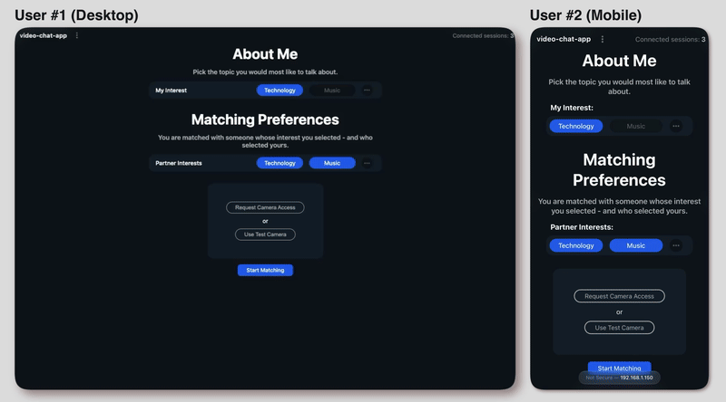
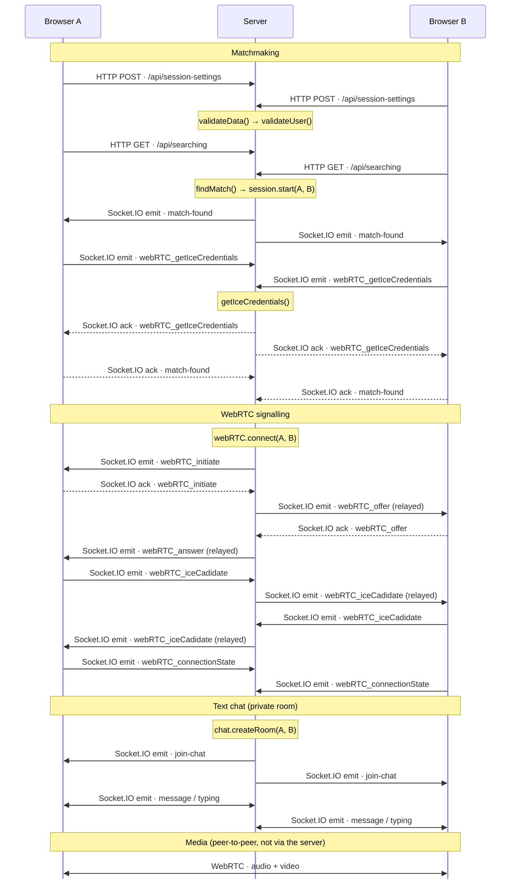

<div align="center">

> This is a locally runnable portfolio refactor from a 2024 private production repo.<br>
Branding and marketing material scrubbed and replaced with a neutral theme.

# video-chat-app

A peer-to-peer random video chat React web app<br>
Match with random users based on selected preferences


</div>

<p align="center">
  
</p>

## UI/UX design

Designed and built from scratch, with no UI frameworks or component libraries. The layout works on desktop, mobile and everything in between.

## Tech stack

### Front-end
- **React**: *created using CRA (Create React App) as that was the recommended way to start a React SPA by documentation at the time*
- **WebRTC**: *used for real-time peer-to-peer video and audio communication*
- **`socket.io-client`**: *used as signalling for WebRTC, chat and the online user count*
- **`react-router-dom`**: *to control navigation URL without reloading the page*


### Back-end
- **Node.js**: *as the runtime*
- **Express**: *framework for HTTP server and API routing*
- **`express-session`**: *to create and save client session data between requests*
- **`socket.io`**: *relays WebRTC signalling and chat between matched users, and tracks connected sessions*
- **`lru-cache`**: *in-memory state for users, matchmaking and sessions*
- **Mongoose**: *library for MongoDB*

### Database
- **MongoDB**: *for logging matching activity. No IP addresses or chat content are logged*

### TURN servers
- **[Coturn](https://github.com/coturn/coturn)**: *deployed on a VPS for WebRTC connections that are blocked by NAT and require a relay (TURN) server*


## How it works



### Matchmaking
- `POST /api/session-settings`: *creates user and saves selected preferences to user session*
- `GET /api/searching`: *adds user to the search queue*
- `match-found`: *notifies both browsers that a match has been found*
- `webRTC_getIceCredentials`: *getting STUN/TURN config. Each browser prepares an `RTCPeerConnection`*
- `match-found` (ack): *each browser confirms within 10s, otherwise the match is cancelled. Once both confirm, they leave the search queue*

### WebRTC signalling
- `webRTC_initiate`, `webRTC_offer` and `webRTC_answer`: *SDP exchange*
- `webRTC_iceCadidate`: *network candidates passed through the server so the browsers can find a route to each other*
- `webRTC_connectionState`: *once both browsers report `connected`, the session starts. If that doesn't happen within 20s, both go back to searching*

### Text chat
- `join-chat`: *both users confirm, then the server puts their sockets in a private room*
- `message` / `typing`: *relayed only to the other user in the room. Messages are not stored*

### Media
- *Audio and video go directly between the browsers over `RTCPeerConnection`. If NAT blocks a direct connection, a TURN server relays the media*

## Run it locally

Requires **Node.js 22+**

```bash
git clone https://github.com/Kipras-Skeirys/video-chat-app.git
cd video-chat-app
```

```bash
npm ci          # install dependency versions from package-lock.json
npm run build   # build the React front end into ./build
npm start       # serve the app and API on http://localhost:8000
```

Open `http://localhost:8000` in two separate browser **sessions**, for example a normal window and a private window. Two tabs in the same window share a session, so the newer tab takes over.


All settings have working defaults. To change any, copy `.env.example` to `.env`.


<details>
<summary>Development mode</summary>

Hot reload, in two terminals:

```bash
npm run back-end    # API + Socket.IO on :8000
npm run front-end   # dev server on http://localhost:3000
```

</details>

<details>
<summary>Two devices on a LAN</summary>

Browsers only allow camera access on `https://` or `http://localhost`. Run these in two terminals:

**Terminal 1:**

```bash
npm run back-end               # API + Socket.IO on :8000
```

**Terminal 2:**

```bash
HTTPS=true npm run front-end   # HTTPS dev server on https://<your-LAN-IP>:3000
```

Open `https://<your-LAN-IP>:3000` on both devices and accept the certificate warning. If the devices can't reach each other directly, you'll need TURN.

</details>
